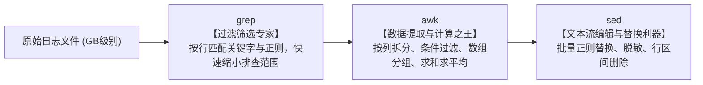
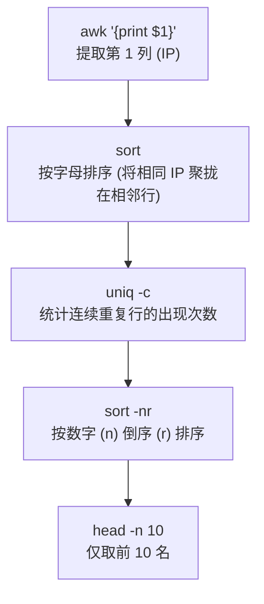

# 实战项目：文本处理三剑客与海量日志分析（Log Analysis Lab）

> **目标**：通过真实还原大厂微服务架构下的生产故障告警场景，熟练掌握 **`grep`、`sed`、`awk`** 三剑客以及 **管道、重定向、`xargs`** 的组合流水线，实现纯命令行下的秒级运维与性能统计。

---

## 一、 三剑客分工哲学：到底什么时候用谁？

很多初学者容易混淆三剑客的使用场景。在工业界，每个工具都有其绝对优势领域：



| 工具 | 核心特长 | 典型杀手级场景 |
| :--- | :--- | :--- |
| **`grep`** | **快速行过滤** | 快速筛查 `ERROR`、提取包含 `500` 的行、打印匹配行的前后 3 行上下文（`-C 3`） |
| **`awk`** | **结构化列提取与计算** | 提取第 7 列（URL）、按 IP 分组统计请求量、计算接口平均耗时（P99/Avg） |
| **`sed`** | **流编辑与正则替换** | 批量修改配置文件、对手机号/身份证等敏感信息进行掩码脱敏替换（`s/old/new/g`） |

---

## 二、 必须刻入肌肉记忆的黄金流水线：`词频统计`

无论是统计算法、流量分析还是面试手撕，下面这行流水线是 Linux 工程师敲得最多的组合：

```bash
awk '{print $1}' access.log | sort | uniq -c | sort -nr | head -n 10
```



> ⚠️ **致命考点**：为什么 `uniq` 之前必须先 `sort`？  
> 因为 `uniq` 只能消除并统计**紧挨着的连续重复行**！如果相同的 IP 分散在第 1 行和第 100 行，不先 `sort` 的话 `uniq` 根本无法汇总它们！

---

## 三、 重定向底层原理：`2>&1` 的秘密

面试高频八股：“`> out.log 2>&1` 到底是什么意思？如果写反成 `2>&1 > out.log` 会发生什么？”

### 1. 文件描述符基础：
* `0`：标准输入（stdin）
* `1`：标准输出（stdout）
* `2`：标准错误（stderr）

### 2. 执行顺序：从左到右依次求值！

#### ✅ 正确写法：`command > out.log 2>&1`
1. 先看 `> out.log`：将 `1`（标准输出）重定向到文件 `out.log`；
2. 再看 `2>&1`：将 `2`（标准错误）重定向到 `1` **当前指向的目标**（即 `out.log`）；
3. **结果**：正常日志与错误日志全部合流输出到 `out.log`。

#### ❌ 错误写法：`command 2>&1 > out.log`
1. 先看 `2>&1`：将 `2` 重定向到 `1` 当前指向的目标（此时 `1` 依然指向**终端屏幕**，所以 `2` 指向了屏幕）；
2. 再看 `> out.log`：将 `1` 重定向到了 `out.log`；
3. **结果**：正常日志进入 `out.log`，但**错误日志依然直接漏到了终端屏幕上**！

---

## 四、 实践项目结构与实操步骤

本项目位于目录：`projects/log_analysis_lab/`

```text
projects/log_analysis_lab/
├── generate_logs.py      # 日志生成器（生成 3000 行网关访问日志与关联微服务日志）
├── challenges.md         # 6 大排障闯关任务书（不看答案自己动手做）
├── solutions.sh          # 官方标准答案与一键自动化演练验证脚本
└── README.md             # 本手册
```

### 1. 移植并生成日志数据
在你的 WSL 终端中执行：
```bash
# 复制到 WSL 环境（如需）或直接进入目录：
cd /mnt/d/Project/Linux_learning/projects/log_analysis_lab

# 生成日志
python3 generate_logs.py
```
执行后会在当前目录生成两个文件：
* `nginx_access.log`（Nginx 网关访问日志，包含 IP、请求方式、URL、状态码、响应字节、耗时）
* `application.log`（后端微服务业务日志，包含 TraceID、手机号/身份证、SQLException 堆栈）

### 2. 闯关挑战
打开 [challenges.md](file:///d:/Project/Linux_learning/projects/log_analysis_lab/challenges.md)，按照里面的 6 个关卡依次手写命令进行排查：
- 关卡 1：【应急排障】定位 5xx 突发接口与错误堆栈
- 关卡 2：【流量画像】统计 Top 客户端 IP 与非 200 状态码分布
- 关卡 3：【性能瓶颈】慢请求分析与纯 awk 分组计算平均耗时
- 关卡 4：【数据合规】sed 正则脱敏手机号与身份证
- 关卡 5：【全链路追踪】trace_id 跨日志级联抓取
- 关卡 6：【管道重定向】tee 与 2>&1 机制实操

### 3. 查看标准答案与自动化核对
遇到卡壳或想对比自己的命令是否最优雅，执行：
```bash
chmod +x solutions.sh
./solutions.sh
```
脚本会依次输出每一关的标准命令、解析及运行结果。
